# Onde intervir para recuperar capacidade de cais

MVP de pipeline de dados em nuvem para apoio à decisão sobre capacidade portuária brasileira, a partir do Estatístico Aquaviário da ANTAQ.

**Disciplina:** Sistemas de Suporte à Decisão · Prof. André Luiz Marques Serrano
**Departamento de Engenharia de Produção · Universidade de Brasília**
Novembro de 2026

---

## Resumo em um parágrafo

Uma autoridade portuária decide todo ano onde aplicar um orçamento de intervenção limitado. O indicador que naturalmente orienta essa decisão é o tempo de berço ocupado sem operação, porque ele é capacidade de cais consumida sem produção. Este trabalho constrói o pipeline que mede esse indicador para as 116.327 atracações ocorridas no Brasil em 2025 e chega a uma conclusão que inverte a leitura usual: **o ranking direto desse indicador aponta para o lugar errado em 9 das 10 principais instalações**. O topo da lista é ocupado por terminais fluviais de barcaça, onde esperar atracado é o modelo logístico e não desperdício. Depois de controlar por modo de navegação e por multiplicidade de posições de atracação, sobram 46.095 horas de berço efetivamente recuperáveis por ano no segmento marítimo de carga, equivalentes a 5,3 posições de cais, e 71% delas estão concentradas em dez terminais, identificados na seção 6.

---

## 1. Objetivo

### O problema de decisão

Capacidade portuária é cara e lenta de construir. Um berço novo leva anos e custa centenas de milhões. Antes de expandir, um gestor portuário ou o regulador precisam responder a uma pergunta mais barata: **quanta capacidade já existente está sendo desperdiçada, e onde?**

Esse é um problema semiestruturado. Não há fórmula fechada que diga onde investir, porque o critério envolve julgamento sobre o que é desperdício evitável. Mas também não é decisão puramente subjetiva, porque o tempo de cada navio em cada berço é medido e declarado. É exatamente a zona em que um sistema de suporte à decisão é útil.

**Quem decide:** autoridade portuária, operador de terminal ou a própria ANTAQ como reguladora.
**O que decide:** onde alocar recurso de intervenção operacional no próximo ciclo.
**O que muda com a resposta:** a lista de instalações priorizadas, e o tipo de intervenção indicada para cada uma, que é diferente conforme o tempo perdido esteja na fila de entrada, na espera atracado ou na própria operação.

### O indicador central

A ANTAQ decompõe oficialmente a permanência de uma embarcação em quatro tempos. Essa decomposição é a espinha dorsal do trabalho, porque **cada tempo aponta para uma intervenção diferente**.

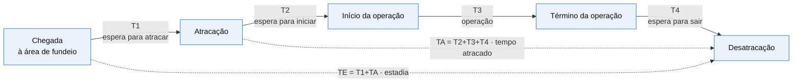

T1 alto sugere falta de berço, canal de acesso ou janela de programação. T3 alto sugere produtividade de equipamento. Já **T2 e T4 são diferentes dos outros dois: são berço ocupado com zero carga se movendo.** Somados, formam o que este trabalho chama de **berço improdutivo**, e são a capacidade mais barata de recuperar, porque dependem de coordenação, documentação e escala de trabalho, não de obra civil.

### Perguntas de negócio

Conforme o enunciado, as perguntas foram fixadas antes de qualquer contato com os dados e permanecem aqui na íntegra, incluindo aquilo que não foi possível responder.

**P1.** Como se decompõe o tempo da embarcação no porto brasileiro, e qual parcela é berço ocupado sem operação?

**P2.** Onde esse tempo improdutivo está concentrado, e quanto de capacidade de cais ele representa?

**P3.** A espera para atracar é explicada por congestionamento, ou por outros fatores? A resposta decide entre investir em berço novo e investir em programação.

**P4.** A produtividade operacional varia mais entre instalações ou entre tipos de carga? A resposta decide se a intervenção deve ser por terminal ou por segmento de carga.

**P5.** Os dados declarados ao regulador são confiáveis o suficiente para sustentar as quatro respostas acima?

P5 não é formalidade. É pré-condição: nenhuma das outras quatro vale mais do que o dado que a alimenta, e no caso deste trabalho a investigação de qualidade acabou mudando a resposta de P2.

---

## 2. Fonte de dados e coleta

**Base:** Estatístico Aquaviário, da Agência Nacional de Transportes Aquaviários (ANTAQ), alimentado pelo Sistema de Desempenho Portuário (SDP). Os dados são declarados pelas próprias autoridades portuárias e terminais autorizados.

**Recorte:** ano de 2025, duas tabelas.

`2025Atracacao.txt` traz 116.327 atracações em 29 colunas, uma linha por atracação, com as cinco marcas de tempo, o berço, a instalação e o tipo de navegação.

`2025Carga.txt` traz 2.467.854 itens de carga em 27 colunas, uma linha por item, com peso bruto, TEU, natureza e sentido.

**Volume total:** 494 MB em texto, separador `;`, codificação UTF-8 com BOM, decimal com vírgula.

**Coleta:** `scripts/coleta.py`. A ANTAQ migrou o painel em 2026 e o endereço `web3.antaq.gov.br` saiu do ar, então o script tenta os endpoints conhecidos e, se nenhum responder, imprime o roteiro de download manual pelo painel em `gov.br/antaq/pt-br/assuntos/estatistica`, aba Base de Dados. Nos dois casos ele grava um **manifesto de coleta** com origem, data, número de linhas, número de colunas e hash SHA256 de cada arquivo. O manifesto está em [`evidencias/manifesto_coleta_2025.json`](evidencias/manifesto_coleta_2025.json) e permite a qualquer pessoa verificar que trabalhou sobre exatamente o mesmo arquivo.

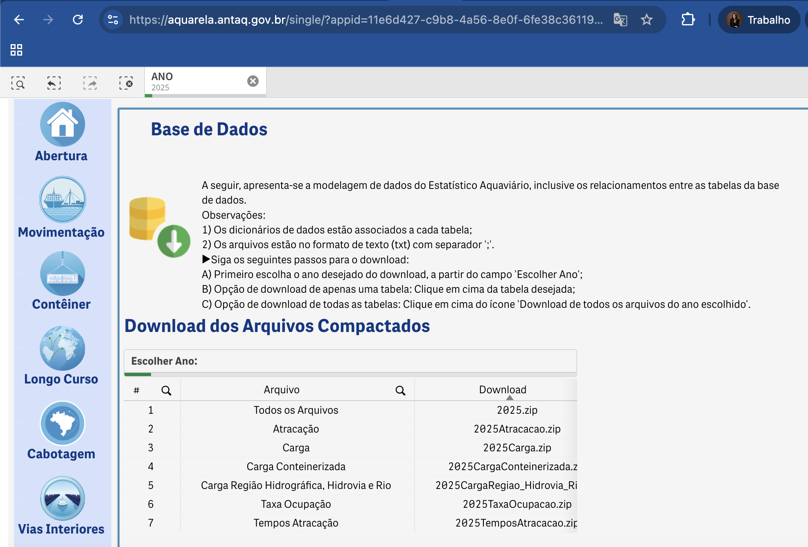

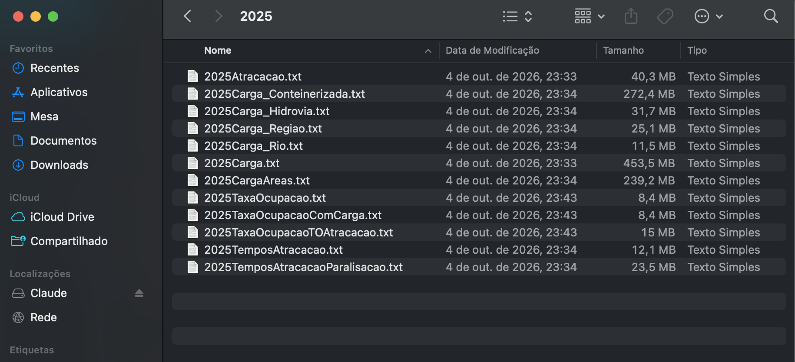

**Licença e ética:** dado público, uso livre com citação da fonte. A base **não contém dados pessoais** na acepção da LGPD, porque a unidade de registro é a atracação de uma embarcação, não uma pessoa. Nenhuma anonimização foi necessária. Os arquivos brutos não são versionados neste repositório, por tamanho, e sim reproduzidos pelo script de coleta. Detalhes em [`LICENSE`](LICENSE).

---

## 3. Modelagem

Esquema estrela com uma tabela fato e cinco dimensões. O grão da fato é **uma linha por atracação**, escolhido a partir da pergunta de negócio: capacidade de cais é consumida por atracação.

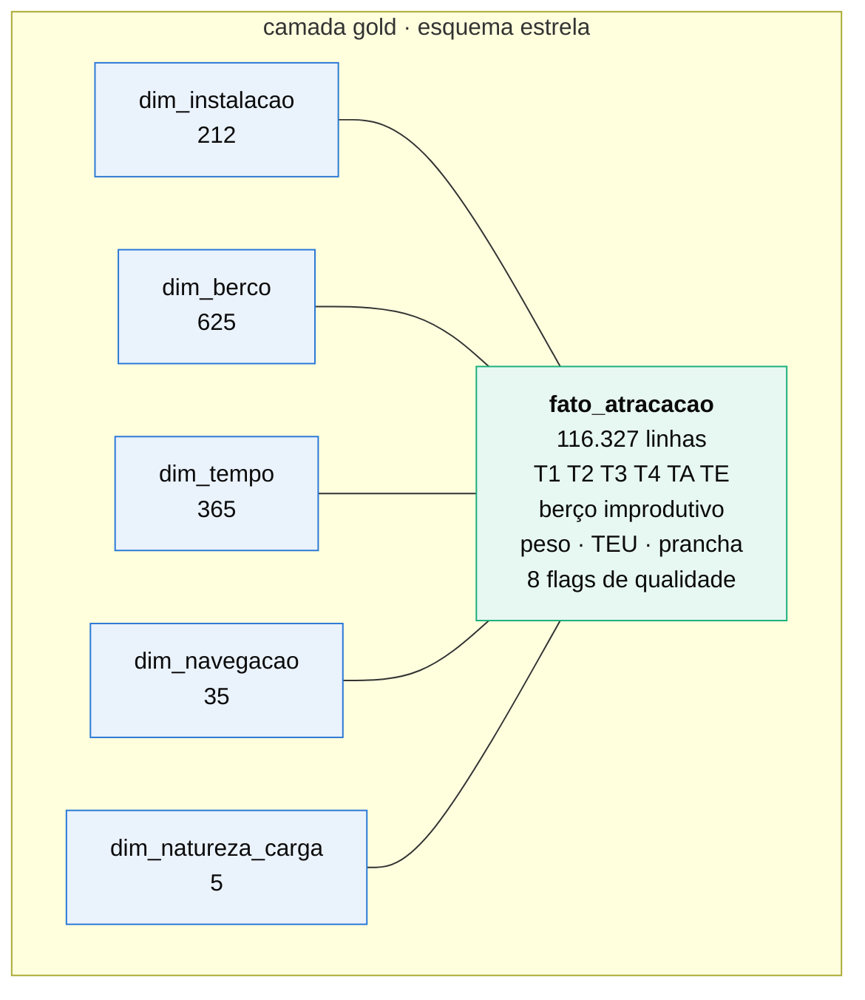

O **catálogo de dados completo** está em [`catalogo/catalogo_dados.md`](catalogo/catalogo_dados.md), com tipo, descrição, domínio observado, obrigatoriedade e linhagem de cada um dos atributos das seis tabelas. Os domínios ali não foram copiados da documentação: foram medidos no dado efetivamente carregado. A justificativa das escolhas de modelagem e o diagrama de linhagem estão em [`catalogo/modelo_dados.md`](catalogo/modelo_dados.md).

### A transformação que importa

As duas tabelas de origem estão em grãos diferentes, e é aí que mora o risco. Uma junção direta entre atracação e carga multiplicaria cada atracação pelo número de seus itens, que chega a 7.292 em um único caso. A tabela fato saltaria de 116 mil para mais de 2 milhões de linhas, e o tempo de operação de cada navio seria contado uma vez por caixa movimentada.

A conciliação correta tem três passos nesta ordem, todos em `scripts/pipeline.py`:

Primeiro, **filtrar** os itens pelas marcas de validação da própria agência, `FlagAutorizacao = S` e `FlagMCOperacaoCarga = 1`, o que remove 173.583 registros ainda em revisão e deixa 2.294.271.

Segundo, **agregar** por `IDAtracacao`, somando peso e TEU, contando itens e elegendo a natureza de carga predominante por maior peso.

Terceiro, **juntar** no grão de atracação, agora em relação um para um.

As 22.145 atracações sem carga correspondente, 19,04% do total, não são falha de junção: são atracações de apoio, passageiro, abastecimento e reparo. Elas ficam na base, marcadas, porque consomem berço mesmo sem mover carga.

### Decisões de tratamento

Valores ausentes **não são imputados**. A ausência é registrada em coluna própria para que possa ser medida como indicador de qualidade em vez de desaparecer sob um substituto.

Registros inválidos **não são excluídos**. São marcados por flags, e cada análise declara qual subconjunto usou. Isso mantém o denominador auditável.

---

## 4. Carga em nuvem

O pipeline existe em duas implementações funcionalmente equivalentes.

A local, em pandas, está em `scripts/pipeline.py` e serve ao desenvolvimento e ao teste.

Os arquivos brutos foram carregados em um Volume do Unity Catalog antes da execução.

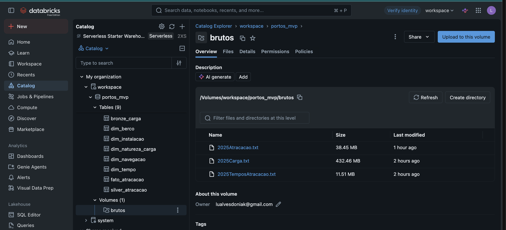

A de nuvem, em PySpark, está em [`notebooks/01_pipeline_databricks.py`](notebooks/01_pipeline_databricks.py) e grava as seis tabelas como Delta no Unity Catalog do Databricks. O notebook termina com quatro verificações: um teste de integridade referencial que acusa qualquer linha da fato sem chave de dimensão, `SHOW TABLES`, `DESCRIBE DETAIL fato_atracacao` e uma consulta de equivalência cujos números devem bater com `outputs/relatorio_qualidade_2025.json`.

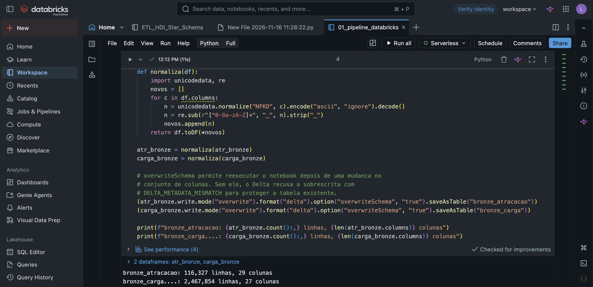

As tabelas resultantes ficam materializadas no catálogo, em formato Delta.

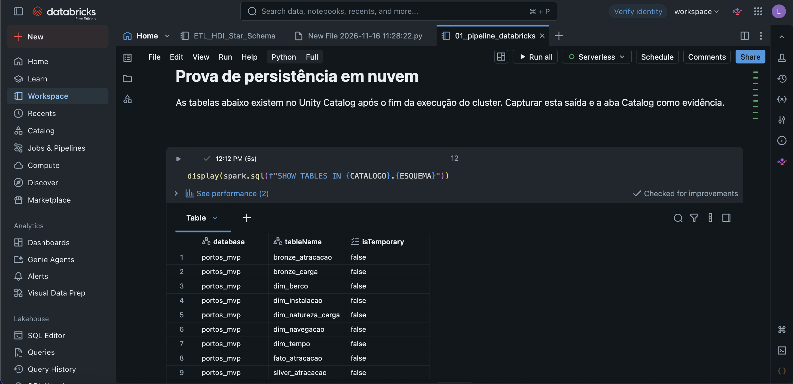

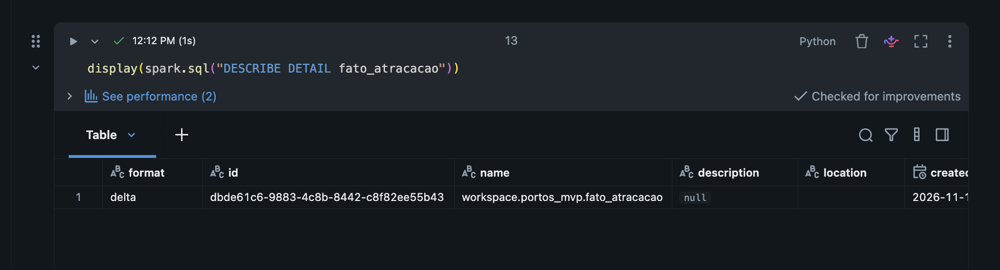

A equivalência entre as duas implementações foi verificada no resultado, e não apenas nas contagens: a consulta final do notebook, executada em SQL sobre as tabelas Delta, devolve as mesmas quinze instalações, na mesma ordem e com as mesmas contagens de atracação, que o pipeline local produz em `outputs/ranking_maritimo_2025.csv`. São dois caminhos independentes, em linguagens e motores diferentes, partindo dos mesmos arquivos brutos e chegando ao mesmo resultado linha a linha.

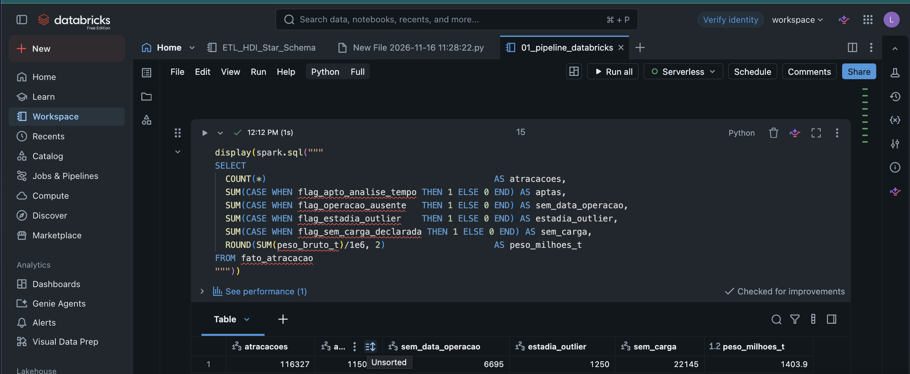

Vale registrar uma decisão técnica que custou uma reexecução. A primeira versão do notebook gerava as chaves sintéticas das dimensões com `monotonically_increasing_id()`. Essa função não é determinística: como o Spark avalia de forma preguiçosa e recalcula a coluna a cada ação, a chave gravada na dimensão não era a mesma gravada na tabela fato, e a junção deixava de casar. O sintoma foi discreto e perigoso, porque o pipeline terminava sem erro e apenas a consulta final devolvia um resultado empobrecido. A correção foi gerar a chave com `row_number()` sobre uma ordenação fixa, gravar as dimensões antes da fato e relê-las do Delta para montar a junção. O teste de integridade referencial foi acrescentado justamente para que uma falha desse tipo passe a ser detectada pelo próprio pipeline, e não pela inspeção do resultado.

A captura decisiva, porém, é outra: o catálogo reaberto **bem depois do fim da execução**, com as tabelas ainda presentes e consultáveis. As tabelas foram criadas às 11h54 e seguiam disponíveis às 13h54, duas horas mais tarde, fora de qualquer sessão de processamento ativa. É o que distingue persistência real de resultado que existia apenas na memória da sessão.

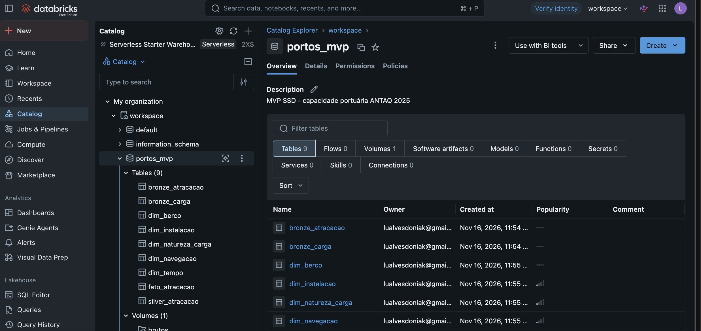

O conjunto completo das capturas está em `evidencias/`, e o que cada uma comprova está descrito em [`ROTEIRO_EVIDENCIAS.md`](evidencias/ROTEIRO_EVIDENCIAS.md).

---

## 5. Qualidade dos dados (P5)

A auditoria tem duas partes, conforme a seção 3.5a do enunciado.

A primeira mede **cada um dos 59 atributos** das seis tabelas do esquema estrela, individualmente, inclusive os que não apresentaram problema: o enunciado pede que se demonstre a ausência de problema, não apenas que se relatem os encontrados. O resultado está em [`outputs/relatorio_qualidade_2025.md`](outputs/relatorio_qualidade_2025.md) e em [`outputs/qualidade_por_atributo_2025.csv`](outputs/qualidade_por_atributo_2025.csv). Dos 59 atributos, **36 são conformes sem ausências, 15 são conformes com ausências e 8 apresentam violação de domínio**.

A segunda agrega nas seis dimensões clássicas, em [`outputs/relatorio_qualidade_2025.json`](outputs/relatorio_qualidade_2025.json). Ambas saem de `scripts/qualidade.py`.

**Completude.** Média de 95,72% entre os 59 atributos. Os três piores: apelido da instalação, preenchido em 32,1%, região hidrográfica em 47,6% e número IMO da embarcação em 51,5%. A falta do IMO impede qualquer análise por embarcação individual e foi um dos motivos para não seguir por esse caminho. Mais relevante para a decisão, os tempos de operação T2, T3 e T4 existem em 94,2% dos registros: 6.695 atracações, 5,76% do total, não têm data de início ou de término de operação declarada.

**Unicidade.** Zero duplicatas de chave primária nas seis tabelas, e zero duplicatas de grão na fato.

**Consistência.** Zero violações de cronologia: nenhum registro tem atracação antes da chegada, operação antes da atracação ou desatracação antes do término. Seis registros em 116.327 têm chaves estrangeiras órfãs, e são as mesmas seis linhas corrompidas que aparecem com coordenada fora do território nacional. A integridade entre a dimensão de berço e a de instalação é total. Foi feita ainda uma checagem aritmética das medidas derivadas: em 109.632 registros testados, T2 somado a T3 e a T4 reproduz o tempo atracado com **erro máximo de zero**, o que confirma que o cálculo de tempos não introduziu distorção.

**Conformidade.** Dos 59 atributos, 27 têm domínio declarado antes de olhar o dado, e é contra essa declaração que a conformidade é medida. Zero violações em todos os atributos categóricos: tipo de navegação, tipo de operação, natureza de carga, região, UF, tipo de autoridade portuária. As 390 violações encontradas concentram-se em 8 atributos numéricos e são todas do mesmo tipo: **153 estadias e 144 esperas para atracar superiores a um ano inteiro**, além de 73 pranchas acima de 20.000 t/h. São valores fisicamente implausíveis que a fonte publica sem filtro. Não foram excluídos, e sim marcados, e as flags correspondentes removem 1.250 registros de estadia extrema das estatísticas de tendência central.

**Atualidade.** Cobertura de 12 meses, do primeiro ao último dia de 2025. Último dado de desatracação em 31 de dezembro de 2025, 320 dias antes desta entrega. A base é anual e consolidada, então a defasagem é da natureza da fonte. Para uma decisão de alocação de capital com horizonte plurianual, uma defasagem de dez meses é aceitável. Para gestão operacional diária, não seria.

### Acurácia: o teste que mudou o trabalho

As cinco dimensões acima são as de praxe e a base passa bem em todas. O teste que produziu o achado relevante foi outro, de plausibilidade física: **dois navios não podem ocupar o mesmo berço ao mesmo tempo.**

Ordenando as atracações por berço e comparando janelas de ocupação, 36.118 atracações, **31,05% do total**, se sobrepõem a outra no mesmo berço. A sobreposição atinge 408 dos 625 berços, com mediana de 6,8 horas e p95 de 137 horas.

Uma leitura apressada chamaria isso de erro de declaração em massa. A investigação mostra outra coisa. Contando a ocupação simultânea máxima de cada berço ao longo do ano:

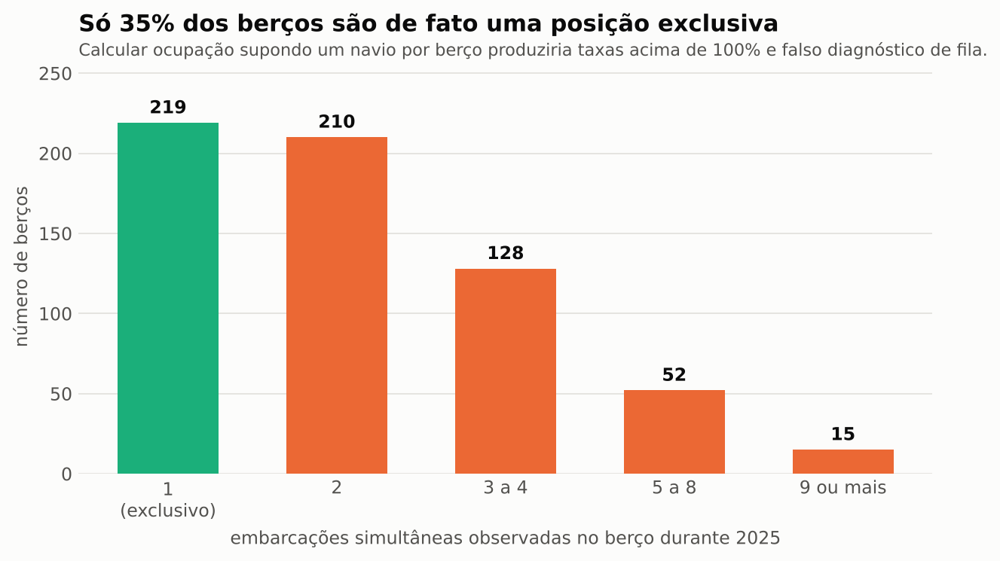

Apenas 219 berços, 35,1%, comportaram uma embarcação por vez. A mediana é de 2 posições simultâneas, o percentil 90 é 5, e há um berço com 125. **`IDBerco` não é uma posição exclusiva de atracação**: é um código que às vezes designa um cais inteiro, uma área de fundeio ou um conjunto de posições.

A consequência é direta e cara. Qualquer cálculo de taxa de ocupação que suponha um navio por berço produziria taxas acima de 100% e diagnosticaria congestionamento onde não há. Por isso o número de posições de cada berço passou a ser **estimado a partir da ocupação simultânea máxima observada**, que é um limite inferior defensável: se duas embarcações couberam ao mesmo tempo, existem ao menos duas posições. É essa estimativa que sustenta a análise de P3.

---

## 6. Resultados

### P1. Para onde vai o tempo da embarcação

Esta foi a primeira resposta a exigir cautela, e a lição é metodológica antes de ser portuária.

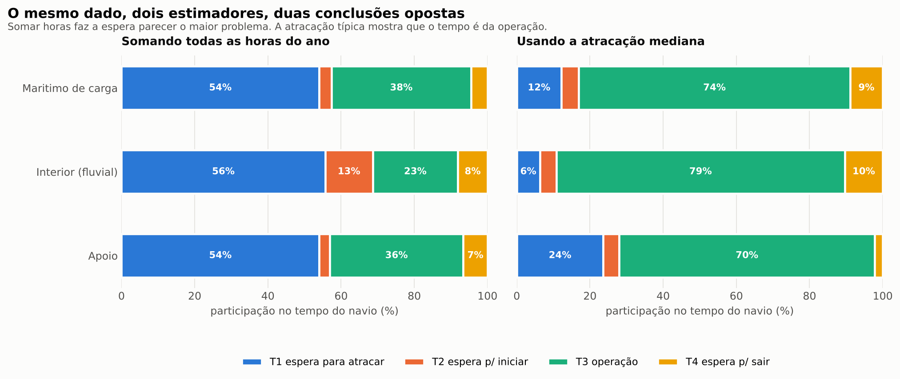

Somando todas as horas do ano, as 108.506 atracações com cadeia temporal completa acumulam **6.575.336 horas de embarcação**, das quais a espera para atracar responde por 54,5% e a operação por apenas 33,4%. A conclusão parece óbvia: o Brasil tem um problema de fila.

A mesma base, lida pela atracação mediana, diz o contrário. A espera cai para 10,8% e a operação sobe para 75,4%.

As duas leituras estão corretas. A diferença vem da assimetria: a distribuição de T1 tem coeficiente de assimetria de 3,88, mediana de 1 hora e média de 33 horas. **Os 10% de atracações com maior espera concentram 68,4% de todas as horas de espera do país**, e o percentil 99 chega a 411 horas.

Isso não é detalhe estatístico, é a diferença entre duas políticas públicas. A leitura por soma recomendaria expandir cais em geral. A leitura por mediana recomendaria investigar a cauda, porque a atracação típica quase não espera e o problema está concentrado em poucos eventos extremos. Este trabalho reporta as duas e adota a segunda como base da recomendação, porque política de capacidade se faz sobre casos, não sobre o agregado.

Quanto ao indicador central, o berço improdutivo responde por **793.178 horas, 26,5% de todo o tempo em que embarcações estiveram atracadas no Brasil em 2025**, o equivalente a 90,5 posições de cais ocupadas o ano inteiro sem mover carga.

### P2. Onde está concentrado, e por que o ranking direto engana

Ordenando as instalações pelo total de berço improdutivo, o topo é este: Cargill Miritituba (PA), Santos (SP), LDC Pederneiras (SP), F. H. de Oliveira Peixoto (RO), Santana (AP), Niterói (RJ).

Antes de transformar isso em recomendação, foi testada a hipótese alternativa de que o indicador estivesse capturando modelo de negócio em vez de ineficiência. O perfil das instalações do topo:

Em Miritituba, a espera para atracar é **zero**, a operação dura 2,5 horas e os tempos de espera atracado somam 87,5 horas, em barcaças de 2.800 toneladas em navegação interior fluvial. Isso não é um porto congestionado. É um ponto de transbordo em que a barcaça atraca e aguarda a formação do comboio. A espera atracada **é** o modelo logístico.

Em Niterói, 543 das 547 atracações são de apoio marítimo, com operação mediana de 30 minutos. São embarcações de apoio offshore, não navios de carga.

Segmentando por modo de navegação, o padrão fica claro. O segmento fluvial tem 52.642 atracações e move 87 milhões de toneladas, com 47,5% do tempo atracado sem operação. O segmento marítimo de carga tem menos atracações, 42.780, move **1,28 bilhão de toneladas**, quinze vezes mais, e tem 17,2% de tempo improdutivo.

O ranking corrigido restringe o universo ao que de fato é capacidade de cais marítimo: navegação de longo curso e cabotagem, operação de movimentação de carga, instalações com pelo menos 50 atracações no ano. Sobram 76 instalações e 30.772 atracações.

**O custo do viés é mensurável: das dez instalações que o ranking direto indicaria para intervenção, apenas uma permanece no top 10 depois da correção.** Nove de dez decisões de priorização teriam sido direcionadas ao lugar errado.

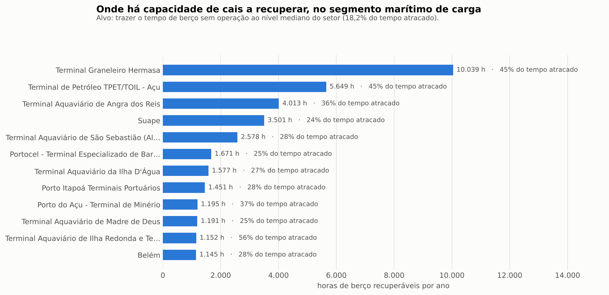

Adotando como alvo trazer cada instalação ao nível mediano do setor, 18,2% do tempo atracado, o potencial é de **46.095 horas de berço por ano, equivalentes a 5,26 posições de cais**, com 71,3% concentrados em dez terminais. O ranking completo está em [`outputs/ranking_maritimo_2025.csv`](outputs/ranking_maritimo_2025.csv).

O mesmo ranking, reproduzido em SQL sobre as tabelas Delta da nuvem, ordenado pelo total absoluto de berço improdutivo:

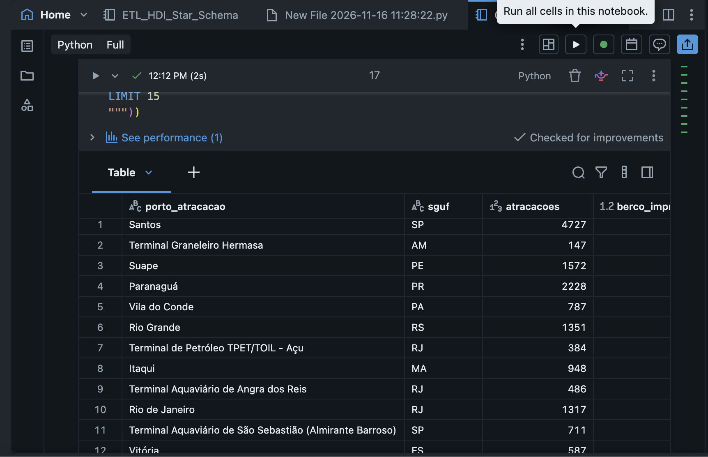

### P3. Fila ou coordenação?

A decisão entre construir berço e reorganizar programação depende de a espera ser ou não explicada por congestionamento.

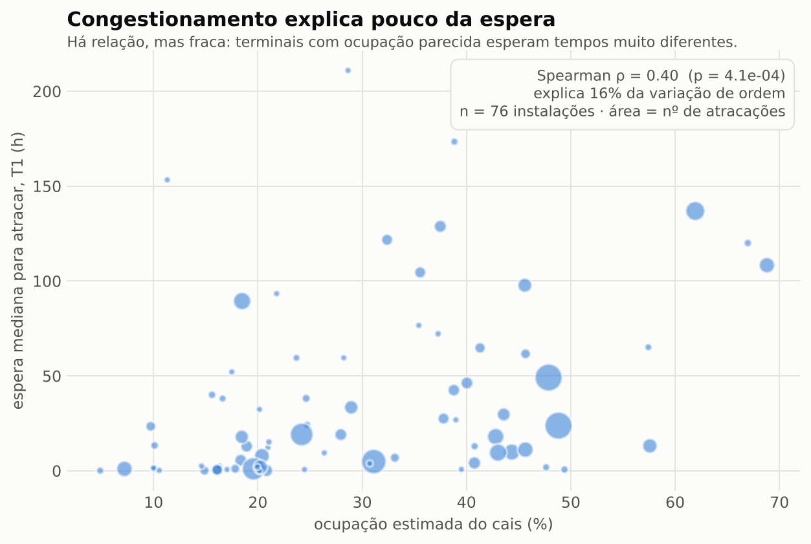

Usando a estimativa de posições descrita na seção 5, a correlação de Spearman entre ocupação do cais e espera mediana para atracar, nas 76 instalações marítimas, é **ρ = 0,396 (p = 0,0004)**. A relação existe e é estatisticamente significativa, mas explica cerca de **16% da variação de ordem**. A ocupação mediana do setor é de 21,4%.

Em termos de decisão: ocupação de cais à casa dos 20% não é um sistema saturado, e o congestionamento responde por uma fração pequena da diferença de espera entre terminais. Para a maioria das instalações da lista, **berço novo não é a intervenção indicada**. Os outros 84% da variação ficam por conta de fatores que esta base não contém: programação de atracação, restrição de maré e calado, disponibilidade de prático e rebocador, condição meteorológica, e a própria política comercial do terminal.

Isso é uma limitação honesta do trabalho e, ao mesmo tempo, o resultado mais acionável dele: ele exclui a hipótese mais cara antes que alguém invista nela.

### P4. Intervir por terminal ou por tipo de carga?

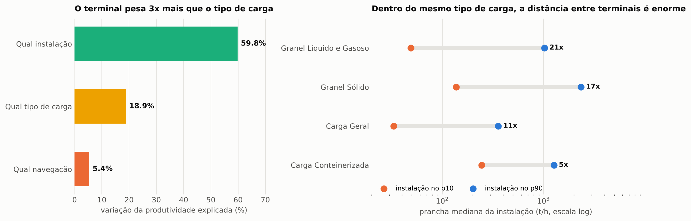

Decompondo a variação do logaritmo da prancha operacional nas 78.618 atracações exclusivas com produtividade plausível, **a instalação explica 59,8% da variação, contra 18,9% do tipo de carga e 5,4% do modo de navegação**. O terminal pesa mais de três vezes o produto que ele movimenta.

Dentro de um mesmo perfil de carga, a distância entre terminais é grande. Em granel líquido, a instalação no percentil 90 é 21 vezes mais produtiva que a do percentil 10. Em granel sólido, 17 vezes. Em carga conteinerizada, onde a tecnologia é mais padronizada, a razão cai para 5 vezes.

A implicação para a decisão é clara: **política de produtividade portuária deve ser desenhada por terminal, não por segmento de carga.** E a carga conteinerizada, justamente por ser a mais homogênea, é onde há menos a ganhar com intervenção terminal a terminal.

### Síntese: o que fazer com isso

Para as dez instalações do ranking corrigido, a recomendação não é a mesma, e é a decomposição que a diferencia.

Onde T2 e T4 dominam, como em Terminal Graneleiro Hermasa (44,6% do tempo atracado sem operação, 10.039 horas recuperáveis), a intervenção é de coordenação: liberação documental, escala de turno, sequenciamento de equipe. Custa pouco e é rápida.

Onde T3 domina e a prancha está no percentil baixo do seu tipo de carga, a intervenção é de equipamento, e aí sim há capital envolvido.

Onde T1 domina mas a ocupação é baixa, o caminho é a programação de janelas, não a obra.

Essa separação é o produto do MVP. Ela não diz quanto investir, mas elimina classes inteiras de intervenção para cada terminal, que é o que um sistema de suporte à decisão deve fazer.

---

## 7. Como reproduzir

```bash
git clone <url-deste-repositorio>
cd mvp-portos
python -m venv .venv && source .venv/bin/activate
pip install -r requirements.txt

# 1. Coleta (gera o manifesto com hash dos arquivos)
python scripts/coleta.py --ano 2025 --dest dados_brutos

# 2. Pipeline bronze -> silver -> gold
python scripts/pipeline.py --raw dados_brutos --out . --ano 2025

# 3. Auditoria de qualidade (P5)
python scripts/qualidade.py --proj . --ano 2025

# 4. Análise inicial (P1 a P4)
python scripts/analise.py --proj . --ano 2025

# 5. Testes críticos das hipóteses alternativas
python scripts/diagnostico_critico.py . 2025

# 6. Análise corrigida por segmento
python scripts/analise_segmentada.py --proj . --ano 2025

# 7. Figuras e catálogo
python scripts/graficos.py --proj . --ano 2025
python scripts/gerar_catalogo.py --proj . --ano 2025

# 8. Notebook de análise (monta e executa, deixando as saídas embutidas)
python scripts/montar_notebook.py . 2025
jupyter nbconvert --to notebook --execute --inplace notebooks/02_analise.ipynb

# 9. Conferência: cada número do README contra os arquivos de outputs/
python scripts/verificar_readme.py . 2025
```

Para a nuvem, importar `notebooks/01_pipeline_databricks.py` no Databricks, subir os dois arquivos brutos para um Volume do Unity Catalog e ajustar `CAMINHO_BRUTO` na segunda célula.

Quem quiser apenas ler os resultados sem rodar nada pode abrir [`notebooks/02_analise.ipynb`](notebooks/02_analise.ipynb), que está versionado já executado, com todas as saídas visíveis.

### Estrutura do repositório

```
README.md                     documento principal
LICENSE                       licença do código e dos dados
requirements.txt
scripts/
  coleta.py                   download e manifesto de coleta
  pipeline.py                 bronze -> silver -> gold
  qualidade.py                auditoria dos 59 atributos e das 6 dimensões
  analise.py                  P1 a P4, leitura inicial
  diagnostico_critico.py      testes de hipóteses alternativas
  analise_segmentada.py       P1 a P4 corrigidos
  graficos.py                 figuras
  gerar_catalogo.py           catálogo a partir do dado real
  montar_notebook.py          monta o notebook de análise
  perfilamento.py             exploração inicial
  verificar_readme.py         confere cada número deste README contra outputs/
notebooks/
  01_pipeline_databricks.py   coleta, transformação e carga em PySpark,
                              com persistência Delta no Unity Catalog
  02_analise.ipynb            análise das perguntas P1 a P5, já executado
catalogo/
  catalogo_dados.md           59 atributos: domínio esperado, observado e linhagem
  modelo_dados.md             justificativa do modelo e diagramas
evidencias/
  ROTEIRO_EVIDENCIAS.md       o que capturar e o que cada captura prova
  manifesto_coleta_2025.json  origem, volume e hash SHA256 dos arquivos
dados/gold/                   esquema estrela em parquet, 6 MB, versionado
                              para permitir explorar o resultado sem baixar
                              os 494 MB de origem
outputs/
  relatorio_qualidade_2025.md      auditoria legível, atributo por atributo
  relatorio_qualidade_2025.json    as seis dimensões de qualidade
  qualidade_por_atributo_2025.csv  os 59 atributos em formato tabular
  resultados_analise_2025.json
  resultados_segmentados_2025.json
  ranking_maritimo_2025.csv
  ocupacao_instalacoes_2025.csv
  figuras/
```

---

## 8. Autoavaliação

### Quais perguntas foram respondidas e quais não

P1, P2, P4 e P5 foram respondidas com os dados disponíveis.

**P3 foi respondida apenas pela metade, e isso é o resultado.** Ficou demonstrado que congestionamento explica cerca de 16% da variação de espera entre terminais marítimos, o que **exclui** a hipótese de saturação generalizada e, com ela, a recomendação de expansão de cais. Mas os 84% restantes não foram explicados, porque as variáveis que os explicariam, programação de atracação, maré, calado, disponibilidade de praticagem e clima, não estão nesta base. A pergunta permanece aqui porque responder "não é congestionamento" já muda a decisão, mesmo sem dizer o que é.

### Que limitações dos dados condicionaram os resultados

A mais séria é que `IDBerco` não representa uma posição exclusiva de atracação. A estimativa de posições por ocupação simultânea máxima é um contorno razoável, mas é inferência, não medição: subestima posições em berços de baixo movimento, onde a simultaneidade pode simplesmente não ter sido observada, e isso infla a ocupação calculada para esses casos.

A segunda é que 5,76% das atracações não têm data de operação declarada, o que remove de toda a análise de produtividade justamente os registros potencialmente mais problemáticos. A ausência pode não ser aleatória, e se não for, a produtividade média está superestimada.

A terceira é que o peso bruto de carga conteinerizada inclui a tara do contêiner, o que infla a prancha desse segmento em relação às demais naturezas. As comparações de produtividade feitas aqui são válidas **dentro** de cada natureza de carga, não entre elas, e é assim que estão apresentadas.

A quarta é que os dados são declarados pelas próprias instalações ao regulador. Há incentivo assimétrico: um terminal não tem motivo para declarar tempo improdutivo a mais. Se existe viés sistemático, ele aponta para subestimação, o que torna os 46.095 horas recuperáveis um piso, não um teto.

### Que decisões técnicas seriam tomadas de outra forma

A principal: o diagnóstico crítico foi feito **depois** da primeira análise, e deveria ter vindo antes. A primeira versão deste trabalho produziu um ranking, uma recomendação e um número de capacidade recuperável que estavam errados por fator superior a quatro, e só o teste de hipóteses alternativas revelou isso. Se o prazo tivesse sido mais curto, o resultado errado teria sido entregue com a mesma aparência de rigor. Em um próximo trabalho, o perfilamento por segmento viria antes de qualquer agregação nacional.

A segunda: o limite de 30 dias para marcar estadia como outlier foi escolhido por plausibilidade, não por critério estatístico derivado da própria distribuição. Um critério baseado em percentil por tipo de navegação seria mais defensável, já que 30 dias significam coisas diferentes para uma barcaça e para um navio em reparo.

A terceira: a prancha foi calculada sobre peso bruto porque é o que a base oferece de forma consistente. Para granel, tonelada por hora é a medida certa. Para contêiner, movimentos por hora seria melhor, e a base até traz TEU, mas misturar as duas métricas numa coluna única comprometeria a comparabilidade.

### Que extensões transformariam isto em solução de uso contínuo

Automatizar a verificação de qualidade como controle de regressão, de modo que cada atualização mensal da ANTAQ dispare os mesmos testes e sinalize degradação, em vez de depender de auditoria manual.

Incorporar as fontes que explicariam os 84% não explicados de P3: tábua de marés, calado operacional declarado e dados meteorológicos por porto. Isso transformaria P3 de uma exclusão de hipótese em uma atribuição de causa.

Estender a série para 2015 a 2026, o que permitiria separar variação estrutural de variação conjuntural e avaliar se intervenções já realizadas em terminais específicos produziram efeito mensurável, aproximando o trabalho de um desenho quase experimental.

Substituir a estimativa de posições por berço pelo cadastro físico de instalações portuárias da própria ANTAQ, que é publicado separadamente e eliminaria a maior fonte de incerteza do trabalho.

---

## Referências

AGÊNCIA NACIONAL DE TRANSPORTES AQUAVIÁRIOS (ANTAQ). **Documentação do Estatístico Aquaviário**, versão 2026. Brasília: ANTAQ, 2026.

AGÊNCIA NACIONAL DE TRANSPORTES AQUAVIÁRIOS (ANTAQ). **Estatístico Aquaviário: base de dados 2025**. Disponível em: https://www.gov.br/antaq/pt-br/assuntos/estatistica. Acesso em: 16 nov. 2026.

GORRY, G. A.; SCOTT MORTON, M. S. A framework for management information systems. **Sloan Management Review**, v. 13, n. 1, p. 55-70, 1971.

KIMBALL, R.; ROSS, M. **The Data Warehouse Toolkit**. 3. ed. Indianapolis: Wiley, 2013.

LITTLE, R. J. A.; RUBIN, D. B. **Statistical Analysis with Missing Data**. 2. ed. Hoboken: Wiley, 2002.

SIMON, H. A. **The New Science of Management Decision**. New York: Harper & Row, 1960.

TUKEY, J. W. **Exploratory Data Analysis**. Reading: Addison-Wesley, 1977.
