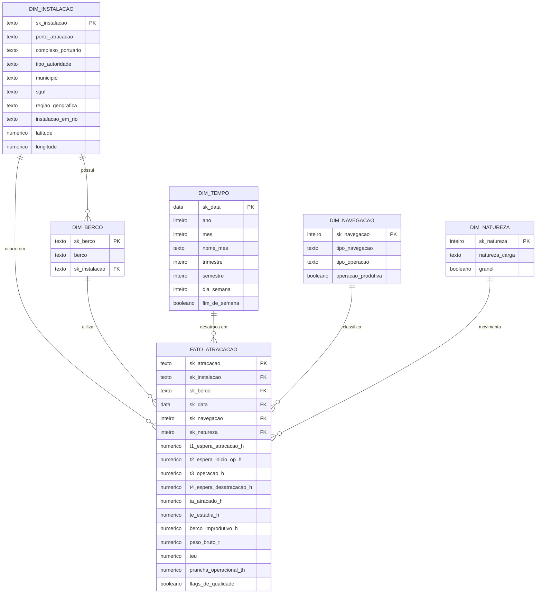
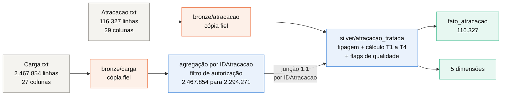

# Modelo de Dados

## Decisão de modelagem

O modelo é um **esquema estrela**, com uma tabela fato e cinco dimensões.

A escolha do grão veio da pergunta de negócio, não da conveniência de processamento. A decisão que este MVP apoia é onde intervir para recuperar capacidade de cais, e capacidade de cais é consumida por **atracação**. Por isso o grão da tabela fato é **uma linha por atracação**.

Essa definição tem uma consequência irreversível que precisa ficar explícita: uma vez agregado por atracação, o detalhe de cada item de carga deixa de ser recuperável na camada analítica. Foi uma escolha consciente. A granularidade de item de carga serviria a uma pergunta sobre mix de mercadorias, que não é a pergunta deste trabalho. O detalhe permanece disponível na camada bronze para quem precisar reabrir essa questão.

## Diagrama

## Linhagem: do arquivo bruto à camada analítica

## O ponto crítico da transformação: conciliação de grãos diferentes

As duas tabelas de origem estão em grãos distintos. `Atracacao.txt` tem uma linha por atracação. `Carga.txt` tem uma linha por item de carga, e uma mesma atracação pode ter milhares de itens, com máximo observado de 7.292.

Uma junção direta entre as duas multiplicaria cada atracação pelo número de seus itens de carga e inflaria qualquer soma de tempo em ordens de grandeza. A tabela fato passaria de 116.327 para mais de 2 milhões de linhas, e o tempo de operação de um navio seria contado uma vez para cada caixa movimentada.

A transformação correta tem três passos, nesta ordem:

1. **Filtrar** os itens de carga pelas marcas de validação da própria agência, `FlagAutorizacao = S` e `FlagMCOperacaoCarga = 1`. Isso remove 173.583 itens, que são registros ainda em revisão pela ANTAQ.
2. **Agregar** por `IDAtracacao`, somando peso bruto e TEU, contando itens e identificando a natureza de carga predominante por maior peso.
3. **Juntar** o resultado, agora no grão de atracação, por `IDAtracacao`, em relação um para um.

As 22.145 atracações sem nenhum item de carga correspondente, 19,04% do total, não são erro de junção. São atracações de apoio, passageiro, abastecimento e reparo, que de fato não movimentam carga. Elas são preservadas e marcadas em `flag_sem_carga_declarada`, porque consomem berço mesmo sem movimentar carga, e portanto importam para a decisão sobre capacidade.

## Por que esquema estrela e não tabela única

A alternativa seria manter um único arquivo largo com todos os atributos repetidos linha a linha. O esquema estrela foi escolhido por três razões práticas neste problema:

A primeira é que as dimensões de instalação e de berço são consultadas de forma independente da fato. A pergunta sobre multiplicidade de posições por berço, que acabou sendo determinante para o resultado, é respondida com uma junção entre a dimensão de berço e a fato, e seria desnecessariamente cara em formato largo.

A segunda é que os atributos descritivos da instalação mudam de significado ao longo do tempo, enquanto os fatos não. Separar a descrição do evento deixa essa diferença explícita.

A terceira é auditabilidade. Cada medida da tabela fato tem linhagem declarada até a coluna de origem, e cada atributo descritivo tem um único lugar onde é definido. Uma inconsistência de nome de porto, por exemplo, aparece em uma linha da dimensão, não espalhada por milhares de linhas de fato.
